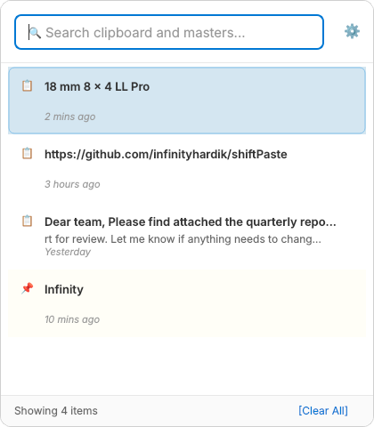
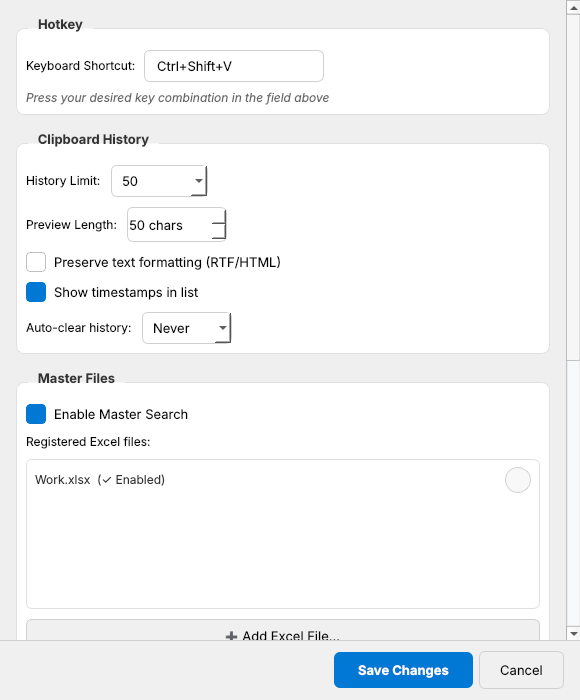

# Shift Paste — Codebase Report

> A plain-language map of the whole app: what it does, how the pieces fit, how data flows,
> and where the sharp edges are. Written so a newcomer (human or AI) can get productive fast.
>
> Snapshot of commit `0e882de`, app version **1.1.0**.
> About 4,000 lines of Python in `src/` + `main.py` (19 modules). No tests in the repo.

---

## 0. TL;DR — the app in one breath

Shift Paste is a **Windows tray app** (Python + PySide6/Qt) that:

1. **Polls the clipboard** every 0.4 s and saves every new piece of text into a **SQLite** database (deduplicated by SHA-256).
2. **Indexes "master" Excel files** (first column of the active sheet) into the same database, and re-indexes them when they change on disk.
3. Listens for a **global hotkey** (`Ctrl+Shift+V`) and pops up a small **search window next to the mouse cursor**.
4. As you type, it runs a **"characters in order" fuzzy search** over history + masters, ranks by **70% recency + 30% match quality**, and shows the top 20.
5. When you pick an item it **copies it to the clipboard, puts focus back on the window you were in, and simulates `Ctrl+V`**.

**Mental model:** _clipboard watcher → SQLite ← Excel indexer_, then _hotkey → popup → search → paste back_.

---

## 1. What the user sees

| Thing | How you get there | What it does |
|---|---|---|
| **Popup** (420×480, frameless, always on top) | `Ctrl+Shift+V`, or left/double-click the tray icon | Search box + result list + footer ("Showing N items", "[Clear All]") |
| **Tray icon** | Always present while running | Menu: Open / Settings / Clear History / Exit |
| **Settings dialog** | Tray → Settings, ⚙️ in popup, or `Ctrl+,` in popup | Hotkey, history options, master files, startup/security, app exclusions, search delay |

Popup keyboard and mouse controls:
- Type to search (results update 80 ms after you stop typing).
- `↑`/`↓` move the selection. The first row is selected automatically.
- `Enter`, or a **single click** on a row → paste that row.
- `Esc`, or clicking anywhere else (focus loss) → close.
- `Ctrl+Delete` → clear history (asks first). `Ctrl+,` → settings.

Rows show 📋 for clipboard history and 📌 (on a pale yellow background) for master items, the first ~50 characters as a bold title, characters 50–150 as a grey subtitle, and a relative time ("5 mins ago").

| Popup | Settings |
|---|---|
|  |  |

_Screenshots were rendered headlessly on Linux with the real widget code, so fonts differ from Windows (no Segoe UI)._

---

## 2. Repository map

```
shiftPaste/
├── main.py                     (62)  Entry point: sys.path fix, Windows AppUserModelID + DPI awareness, run app
├── src/
│   ├── __init__.py             (4)   __version__ = "1.0.0"  ← stale; the real version is 1.1.0 in app.py
│   ├── app.py                  (345) ShiftPasteApp: builds every component, wires signals, handles lifecycle
│   ├── core/
│   │   ├── clipboard_monitor.py(258) QThread that polls the clipboard; skips password managers
│   │   ├── search_engine.py    (295) Fuzzy "in-order" matcher + recency/quality ranking + "time ago" strings
│   │   ├── master.py           (289) Excel indexing + QThread that polls file modification times
│   │   └── paste.py            (172) Remember the foreground window, restore it, simulate Ctrl+V (pynput)
│   ├── data/
│   │   └── database.py         (524) SQLite schema, migrations, CRUD, SQL LIKE pre-filter for search
│   ├── ui/
│   │   ├── main_window.py      (436) Popup window + custom ItemDelegate that paints each row
│   │   ├── settings_window.py  (485) Settings QDialog
│   │   ├── tray.py             (193) System tray icon + menu
│   │   └── styles.py           (281) QSS stylesheets (popup + settings)
│   └── utils/
│       ├── hotkey.py           (213) Global hotkey via Win32 RegisterHotKey + its own message loop thread
│       ├── autostart.py        (176) HKCU\...\Run registry key (macOS/Linux are stubs)
│       ├── platform_utils.py   (97)  "Which process is in the foreground?" + exclusion check
│       └── paths.py            (214) Where the DB, master files and icons live (dev / frozen / installed)
├── data/Master/*.xlsx          Sample master files (Personal, Pinned, Work). NOT used at runtime (see §9)
├── resources/icons/            app_icon.ico / app_icon.png
├── dist/                       Committed build outputs: ShiftPaste.exe (54 MB), ShiftPaste_Setup.exe (56 MB)
├── shiftpaste.spec             PyInstaller one-file build
├── setup_script.iss            Inno Setup installer script
├── requirements.txt            PySide6, pyperclip, openpyxl, psutil, pynput, pywin32 (Windows)
├── README.md / HOW_TO_BUILD.md User docs (partly out of date, see §13)
└── LICENSE                     MIT
```

---

## 3. Architecture at a glance

```
                         ┌──────────────────────────── ShiftPasteApp (src/app.py) ───────────────────────────┐
                         │  creates everything, owns references, connects all signals, handles quit          │
                         └───────────────────────────────────────────────────────────────────────────────────┘
 BACKGROUND THREADS                                MAIN (Qt GUI) THREAD                              EXTERNAL
 ──────────────────                                ────────────────────                              ────────
 ClipboardMonitor (QThread) ──clipboard_changed──▶ _on_clipboard_changed ──▶ Database.add_clipboard_item ─▶ clipboard.db
   polls pyperclip every 0.4s      (queued)                                         ▲   ▲
                                                                                    │   │
 MasterPollingThread (QThread) ──file_changed────▶ MasterManager.rebuild_index ─────┘   │   ◀── openpyxl reads .xlsx
   stat() each enabled file every 1s                                                    │
                                                                                        │
 Hotkey thread (threading)    ──triggered────────▶ toggle_main_window                   │
   RegisterHotKey + GetMessageW    (queued)         └─▶ show_main_window                 │
                                                         ├─ PasteManager.capture_active_window (remember HWND)
                                                         ├─ Database.get_recent_items(20) ───┘
                                                         └─ MainWindow.show_near_cursor
                                                 MainWindow
                                                   ├─ search_changed ──▶ _on_search_changed ─▶ DB search + FuzzySearchEngine.rank
                                                   ├─ item_selected ───▶ _on_item_selected ─▶ pyperclip.copy + PasteManager.paste_to_active ─▶ Ctrl+V into target app
                                                   ├─ settings_requested ─▶ show_settings ─▶ SettingsWindow ─settings_changed─▶ _on_settings_changed
                                                   └─ clear_requested ──▶ _clear_history
                                                 SystemTrayManager ─ show / settings / clear / exit
```

All the wiring lives in `src/app.py:113-153`. Components never talk to each other directly. They emit Qt signals, and `ShiftPasteApp` reacts.

### Threading model

| Thread | Code | Job | How it reaches the main thread |
|---|---|---|---|
| **Main / GUI** | Qt event loop (`app.exec()`) | All UI, all DB writes, search, paste, Excel re-indexing | — |
| **Clipboard monitor** | `ClipboardMonitor(QThread)` `clipboard_monitor.py:201` | Poll the clipboard, hash the text, emit when it changes | `clipboard_changed` signal, `QueuedConnection` (`app.py:120-123`) |
| **Master poller** | `MasterPollingThread(QThread)` `master.py:46` | `os.path.getmtime` on each enabled file every 1 s | `file_changed` → `MasterManager.rebuild_index`. `MasterManager` is a plain Python object, not a QObject. Running it with PySide6 6.12 showed the slot runs on the **main thread** |
| **Hotkey** | `threading.Thread(daemon=True)` `hotkey.py:115` | `RegisterHotKey` then a blocking `GetMessageW` loop | `triggered` signal, `QueuedConnection` (`app.py:149-152`) |

The SQLite connection is shared and opened with `check_same_thread=False`. In practice only the main thread uses it.

---

## 4. Startup sequence

`main.py` → `ShiftPasteApp.__init__` → `_initialize()` (`app.py:65-111`):

1. **main.py**: put the repo root on `sys.path`. On Windows, set the AppUserModelID `infinityhardik.shiftpaste.1.1` and per-monitor DPI awareness.
2. **QApplication** with `setQuitOnLastWindowClosed(False)`, so the app keeps running in the tray.
3. **Database()**:
   - `migrate_old_data()` copies an old `data/clipboard.db` (and its `Master/` folder) into the user-data directory if the new DB doesn't exist yet.
   - Then it connects, enables `PRAGMA foreign_keys`, creates the tables, and runs the column migrations.
4. **FuzzySearchEngine**, **PasteManager**, then **MasterManager(db)**:
   - Make sure `<userdata>/Master` exists.
   - Register every `*.xlsx` in it (skipping `~$` lock files).
   - Start the polling thread.
   - **Index every enabled file now, synchronously on the main thread.** Big Excel files make startup slower.
5. **ClipboardMonitor** started, with `preserve_formatting` read from settings.
6. **MainWindow** created (hidden). **SystemTrayManager** created (icon shown).
7. **HotkeyManager** started with `hotkey` and `excluded_apps` from settings.
8. `_apply_settings()` → `set_autostart(run_on_startup)`. The default is `'True'`, so **every launch writes the HKCU Run key**.
9. `app.exec()`.

If anything raises during startup, it runs `_emergency_cleanup()` and `sys.exit(1)`.

---

## 5. The key flows, step by step

### 5.1 Something gets copied → saved to history
1. The monitor loop (`clipboard_monitor.py:208-238`) wakes every 0.4 s.
2. If the foreground process is a known password manager, it **skips this tick entirely** (see bug H1).
3. `pyperclip.paste()` → text only (images and files are ignored). It truncates at 1,000,000 chars.
4. If `preserve_formatting` is on (Windows only), it also reads the `"HTML Format"` clipboard format.
5. It computes the SHA-256 of the text. If it differs from `_last_hash`:
   - If `_ignore_next` is set → clear the flag and don't emit (this is the app's own copy).
   - Otherwise → emit `clipboard_changed(text, is_formatted, html)`.
6. Main thread: `Database.add_clipboard_item` (`database.py:213-262`) tries an `INSERT`. On a `UNIQUE(content_hash)` clash it instead bumps `last_copied_at` and `copy_count`. So re-copying old text moves it back to the top.

### 5.2 Hotkey → popup
1. The hotkey thread gets `WM_HOTKEY` and calls `is_app_excluded(excluded_apps)`. This is a case-insensitive substring match against the foreground process name. If the app isn't excluded, it emits `triggered`.
2. Main thread: `toggle_main_window()`. If the popup is visible it closes, otherwise `show_main_window()`:
   - `PasteManager.capture_active_window()` saves `GetForegroundWindow()`. **This must happen before the popup takes focus.**
   - `db.get_recent_items(20)` returns **clipboard history only**. Master items appear only once you type.
   - Add `time_ago` strings, then `MainWindow.update_results` and `show_near_cursor()`.
3. `show_near_cursor` (`main_window.py:305-336`) clears the search box, places the window centred horizontally on the cursor and 15 px below it, clamps it to the **primary screen**, then shows and activates it.

### 5.3 Typing a search
1. `textChanged` → an 80 ms single-shot timer (debounce) → `search_changed(text)`.
2. `_on_search_changed` (`app.py:207-227`):
   - Empty query → recent 20 clipboard items.
   - Otherwise:
     - `db.search_clipboard(q)` and `db.search_masters(q)` each run a **SQL LIKE pre-filter** that returns up to 100 rows.
     - The two lists are merged and sent to `FuzzySearchEngine.rank_search_results`, which re-checks each match exactly and scores it.
     - Keep the top 20.
3. Add `time_ago`, then `update_results`, which redraws the list and selects row 0.

Details of the algorithm are in §7.

### 5.4 Picking an item → paste
`MainWindow._on_item_activated` emits `item_selected(item)` **and then** calls `close()`. The signal is a direct connection, so the whole paste runs before the popup closes:

1. `clipboard_monitor.ignore_next_change()` so the app doesn't re-record its own copy.
2. `pyperclip.copy(content)` copies **plain text only**. Any stored HTML is never used for pasting.
3. `PasteManager.paste_to_active()` (`paste.py:164-171`):
   - `ShowWindow(SW_SHOW)`, then `SetForegroundWindow` (or `BringWindowToTop` if that fails) on the saved window.
   - `sleep(100 ms)`.
   - pynput `Ctrl` down, `v` down, `sleep(20 ms)`, `v` up, `Ctrl` up. On macOS it uses `Cmd`.
4. The popup closes.

The user's clipboard now holds the pasted item. The old clipboard contents are not restored.

### 5.5 A master Excel file changes on disk
1. The poller sees `mtime` increase, then emits `file_changed(path)`.
2. `MasterManager.rebuild_index(path)` (`master.py:187-259`):
   - Opens the workbook with openpyxl in `read_only` and `data_only` mode.
   - Reads **column A of the active sheet, every row, header included**, stripping whitespace and skipping empty cells.
   - `db.update_master_items` deletes that file's old rows and bulk-inserts the new ones in a single transaction.
   - It sets `master_files.last_modified = now()`. This is the time of **indexing**, not the time the file was edited.
3. On any error: `last_error` is set **and `is_enabled = 0`**, which takes the file out of search (see bug M6).

### 5.6 Saving settings
`SettingsWindow._save_all` writes 11 keys (all values stored as strings), then emits `settings_changed`. `ShiftPasteApp._on_settings_changed` then:
- restarts the hotkey thread with the new shortcut and exclusions,
- re-applies autostart,
- pushes `preserve_formatting` to the monitor.

Everything else that gets saved is ignored (see §6.2).

Note the inconsistency: adding or removing a **master file takes effect immediately** (even if you press Cancel), while removing an **excluded app** only takes effect after Save.

### 5.7 Clear history / Quit
- **Clear**: shows a confirmation `QMessageBox`, then `DELETE FROM clipboard_items` and `VACUUM`. Master items are kept. If the popup was open, it reloads.
- **Quit** (tray → Exit): stop the monitor, hotkey, and master poller (each waits up to 2 s, then terminates), close the DB, hide the tray icon, then `QCoreApplication.quit()`.

---

## 6. Data model

### 6.1 SQLite schema (`database.py:86-152`)

```
clipboard_items                         master_files                       master_items
───────────────                         ────────────                       ────────────
id              INTEGER PK              id            INTEGER PK  ◀──┐     id             INTEGER PK
content         TEXT NOT NULL           file_path     TEXT UNIQUE    └──── master_file_id INTEGER FK (ON DELETE CASCADE)
content_hash    TEXT UNIQUE (sha256)    is_enabled    INTEGER (1/0)        content        TEXT NOT NULL
created_at      TIMESTAMP               last_modified TIMESTAMP            row_number     INTEGER (1-based Excel row)
last_copied_at  TIMESTAMP  (indexed)    last_error    TEXT NULL
copy_count      INTEGER
is_formatted    INTEGER (1/0)           settings
formatted_content TEXT NULL (HTML)      ────────
                                        key   TEXT PK
                                        value TEXT  ("True"/"False", numbers as text, CSV lists)
```

- **Timestamps** are Python `datetime.now()` values (**local time**). Python's built-in sqlite3 date adapter turns them into text like `2026-11-09 09:54:09.409049`. That adapter is deprecated since Python 3.12 and prints a `DeprecationWarning`.
- **Migrations** (`_run_migrations`) only add missing `clipboard_items` columns and backfill `content_hash`. `SCHEMA_VERSION = 2` is declared but never stored or checked.

### 6.2 Settings keys — which ones actually do anything

| Key | Default | Set in UI by | **Actually read by runtime?** |
|---|---|---|---|
| `hotkey` | `Ctrl+Shift+V` | text field | ✅ `app.py:144, 254` |
| `excluded_apps` | `''` (CSV) | list + Add | ✅ `app.py:145, 255` |
| `run_on_startup` | `True` | checkbox | ✅ `app.py:158, 260` |
| `preserve_formatting` | `False` | checkbox | ⚠️ HTML is captured and stored but **never pasted** |
| `history_limit` | `50` | combo | ❌ nothing ever trims history |
| `preview_length` | `50` | spinbox | ❌ hard-coded 50/150 chars in `ItemDelegate.paint` |
| `show_timestamps` | `True` | checkbox | ❌ timestamps always drawn |
| `auto_clear` | `Never` | combo | ❌ no scheduler exists |
| `enable_masters` | `True` | checkbox | ❌ masters always searched |
| `exclude_password_managers` | `True` | checkbox | ❌ exclusion always on |
| `search_debounce_ms` | `80` | spinbox | ❌ hard-coded `SEARCH_DEBOUNCE_MS = 80` (`main_window.py:178`) |

**7 of the 11 settings are saved but have no effect.**

### 6.3 Where files live (`src/utils/paths.py`)

| What | Location |
|---|---|
| User-data root | Windows `%LOCALAPPDATA%\ShiftPaste` · macOS `~/Library/Application Support/ShiftPaste` · Linux `$XDG_DATA_HOME/ShiftPaste` or `~/.local/share/ShiftPaste` |
| Database | `<root>/clipboard.db` |
| Master folder (scanned at startup) | `<root>/Master/` |
| Icons | dev: `<repo>/resources/icons` · frozen: `sys._MEIPASS/resources/icons` (falls back to `<exe dir>/resources`) |
| Legacy migration source | `<app dir>/data/clipboard.db` or `<cwd>/data/clipboard.db`, plus the sibling `Master/` folder. Only used if the new DB doesn't exist |

The same user-data location is used in dev, frozen and installed mode. The README still says `data/clipboard.db` and `data/Master/`; that's outdated.

---

## 7. The search algorithm in detail

Search runs in **two stages**.

**Stage 1: SQL pre-filter** (`database.py:429-437`, `465-474`). The query, minus spaces and lower-cased, becomes a LIKE pattern with `%` between every character: `"1884"` → `%1%8%8%4%`. This runs against `LOWER(content)`.
- Clipboard: `ORDER BY last_copied_at DESC LIMIT 100`. Master: `LIMIT 100` with **no ORDER BY**.
- The pre-filter only narrows the candidates. Ranking happens in Python.

**Stage 2: exact match and score** (`search_engine.py:51-111, 172-229`).
- **Match:** walk the query characters left to right and `find` each one in the lower-cased text after the previous hit. This is greedy and takes the leftmost hit. If any character is missing, there's no match.
- **Quality** = `len(query) / span`, where span runs from the first to the last matched position. If the query appears as a contiguous substring of the text with spaces removed, quality is multiplied by **1.5** (capped at 1.0).
- **Recency** = `exp(-age / T)`, with T = **24 h** for clipboard items and **7 days** for master items.
- **Score** = `0.7 × recency + 0.3 × quality`. Results are sorted descending and the top 20 shown.

Results from running the code:

| Query vs `"18 mm 8 x 4 LL Pro"` | Match? | Quality |
|---|---|---|
| `ro` | ✅ | 1.00 |
| `LP` | ✅ | 0.75 |
| `1884` | ✅ | 0.36 |
| `18 mm` | ✅ | 1.00 |
| `pro18` | ❌ (wrong order) | — |

Ranking test, query `invoice`:

| Item | Age | Recency | Quality | **Score** |
|---|---|---|---|---|
| master "invoice master entry" | indexed 1 min ago | 1.000 | 1.000 | **1.000** |
| clip "i n v o i c e scattered" | 5 min | 0.997 | 0.808 | **0.940** |
| clip "invoice 2024 final" | 30 h | 0.287 | 1.000 | **0.501** |

What this means:
- **Recency dominates.** A sloppy but recent match beats a perfect match from yesterday.
- **Master items always look fresh**, because their timestamp is the last index time, and every app start re-indexes everything.

The `time_ago` text: under 60 s "Just now", then "N mins ago", "N hours ago", "Yesterday", "N days ago" (under 7), "N weeks ago" (under 30), then a date like "Sep 30, 2026".

---

## 8. Platform support (it is effectively Windows-only)

| Feature | Windows | macOS | Linux |
|---|---|---|---|
| Capture clipboard text | ✅ pyperclip | ✅ | ⚠️ needs xclip/xsel/wl-clipboard |
| Password-manager skip | ✅ (by foreground process) | ❌ | ❌ |
| HTML capture | ✅ win32clipboard | ❌ | ❌ |
| **Global hotkey** | ✅ RegisterHotKey | ❌ `ctypes.windll` missing, so the thread errors out | ❌ same |
| Restore focus before paste | ✅ | ❌ | ❌ |
| Simulate paste | ✅ Ctrl+V | ✅ Cmd+V | ✅ Ctrl+V |
| Autostart | ✅ HKCU Run | stub | stub |
| Hotkey app exclusions | ✅ | ❌ | ❌ |

On macOS and Linux the app still starts and the tray icon works. You just can't summon the popup with the keyboard.

---

## 9. Master files: rules of the road

- **Format:** only **column A of the active sheet** is read. Every non-empty cell becomes one item, **including a header row**. The bundled samples have `Content | Timestamp | Notes` headers, so `"Content"` would show up as a searchable item. Other columns are ignored.
- **Discovery:**
  - (a) any `.xlsx` placed in `<userdata>/Master/` is auto-registered at startup;
  - (b) files can be added by hand from Settings (any path).
- **The repo's `data/Master/*.xlsx` are not used** on a fresh install. The migration only copies them if an old `data/clipboard.db` sits next to them, and that file is git-ignored. PyInstaller still bundles `data/` into the exe, but nothing reads it.
- **Change detection:** mtime polling every 1 s. There's no filesystem watcher.
- **Removal:** Settings → ✕ deletes the DB row, and the items go too via the cascade. But a file inside the Master folder is **re-registered at the next startup**.
- **Errors:** a failed read disables the file (`is_enabled = 0`, shown as "⚠ Error" in Settings). Startup only indexes enabled files. The file comes back only if the poller sees it change again and the next read succeeds. Settings has no "re-enable" toggle.

---

## 10. Hotkey and paste internals

**Hotkey** (`src/utils/hotkey.py`)
- The shortcut string is parsed into modifiers (`ctrl/control`, `shift`, `alt`, `win/cmd/super/meta`) plus one key. Allowed keys: `a-z`, `0-9`, `space`, `tab`, `enter/return`, `backspace`, `delete`, `home`, `end`, arrows. **There are no F-keys or punctuation.** An unknown key leaves `vk = 0`, which means "invalid", and the hotkey is silently disabled.
- `RegisterHotKey(None, 1, mods, vk)` ties the hotkey to the listener thread. The loop is `GetMessageW` → `WM_HOTKEY` → `_handle_hotkey`.
- `stop()` posts `WM_QUIT` to that thread and joins it with a 2 s timeout. `update_settings()` does stop() then start().
- `RegisterHotKey` **consumes the key combination system-wide**. Other apps never receive `Ctrl+Shift+V`, which is "paste as plain text" in browsers and Office. That includes apps on the exclusion list: there the popup doesn't open, but the keystroke is still swallowed.
- If registration fails because another app already owns the combo, the only feedback is a `print`. The shipped exe has no console, so the user sees nothing.

**Paste** (`src/core/paste.py`)
- Timing constants: `FOCUS_RESTORE_DELAY = 0.10 s`, `KEY_PRESS_DELAY = 0.02 s`. Both run on the GUI thread, so the UI is blocked about 120 ms per paste.
- If pynput is missing, stub classes stop the import from crashing, and paste becomes a no-op.

---

## 11. Build and distribution

- **PyInstaller** (`shiftpaste.spec`):
  - One-file, windowed exe (`console=False`), UPX on (Qt DLLs and vcruntime excluded from UPX).
  - Uses the icon if present, and `version_info.txt` if it exists (it doesn't in the repo).
  - Bundles `resources/` and `data/`.
  - Lists the Qt, openpyxl, pywin32 and pynput Windows backends as hidden imports.
  - Excludes heavy packages: numpy, pandas, PIL, tkinter, …
- **Inno Setup** (`setup_script.iss`):
  - Needs admin and installs to `Program Files\Shift Paste`.
  - Optional desktop icon. Optional autostart task (writes the HKCU Run key).
  - Before install or uninstall it detects a running exe with `tasklist` and kills it with `taskkill /F` (after asking).
  - Uninstall deletes `{app}`. User data in `%LOCALAPPDATA%\ShiftPaste` is kept.
- **Logging:** everything is `print()` with `[*]`, `[WARN]` or `[ERROR]` prefixes. Because the exe has no console, **production builds have no logs at all**. Use a `console=True` build to debug.
- Built binaries (~110 MB) are **committed to git** under `dist/`.

---

## 12. Known issues and gotchas (ranked)

Legend: 🔬 = reproduced by running the code here · 📖 = from reading the code (mostly Windows-only paths that can't run in this environment).

### High
- **H1 — Passwords can still end up in history.** 📖 `clipboard_monitor.py:210-228`.
  - The password-manager check skips polling while the manager is the *foreground window*, but `_last_hash` isn't updated.
  - Normal use: copy in KeePass/Bitwarden, then switch to the browser to paste. On the next tick the foreground is the browser, the clipboard still holds the password, the hash differs, and **the password gets saved**.
  - Password-manager browser extensions run inside `chrome.exe` etc., so they're never detected at all.
  - The usual fix is to honour the `ExcludeClipboardContentFromMonitorProcessing` / `Clipboard Viewer Ignore` clipboard formats, and/or check the clipboard owner rather than the foreground window.
- **H2 — The next real copy can be silently lost.** 🔬 `clipboard_monitor.py:220-228` + `app.py:236`.
  - `ignore_next_change()` assumes the clipboard *will* change. If you paste the item that's already on the clipboard, the hash doesn't change and the flag stays armed. That's the most common case, because row 0 (the latest copy) is pre-selected.
  - Your **next genuine copy is then dropped**. Reproduced: copy A → paste A → copy B → copy C gives history `[A, C]`.
- **H3 — History grows forever.** 📖 `history_limit` is never enforced and there's no trimming code anywhere. Long-running users accumulate an unbounded DB (each item can be up to 1 MB, plus HTML).

### Medium
- **M1 — Most settings do nothing.** 7 of 11 keys are dead (§6.2). The README's "High CPU usage → increase search delay" advice has no effect.
- **M2 — Text with non-ASCII capitals can't be found.** 🔬 `database.py:429-437`. SQLite `LOWER()`/`LIKE` only fold ASCII, while the query is lower-cased in Python. Neither `école` nor `ÉCOLE` finds "ÉCOLE Paris". This affects accented and Cyrillic text, among others.
- **M3 — No single-instance guard.** 🔬 `app.py:13` says "Single-instance application", but there's no mutex, lock file or local server. A second launch adds a second tray icon and a second monitor that double-counts `copy_count`, and its hotkey registration fails silently.
- **M4 — Autostart is forced on.** 📖 `app.py:155-159` + default `'True'`. Every launch rewrites the Run key, overriding an unchecked installer task. Running from source registers `python.exe main.py` for autostart.
- **M5 — Master-file ranking and timestamps are misleading.** 🔬 The timestamp is the last index time (re-done at every start), so masters always rank as "fresh" and show "x mins ago" from app start.
- **M6 — One bad read disables a master file for good.** 📖 `master.py:261-283`. Any transient read error (e.g., while Excel is saving) sets `is_enabled = 0`. Startup skips disabled files and the UI has no re-enable.
- **M7 — The hotkey is stolen everywhere, even in "excluded" apps** (§10). 📖
- **M8 — Opening from the tray probably pastes into the taskbar.** 📖 `capture_active_window()` runs on the tray click, when the foreground window is likely the taskbar itself, so `Ctrl+V` goes nowhere. Not verifiable here.
- **M9 — Multi-monitor placement is wrong.** 📖 `main_window.py:311-325` clamps to `primaryScreen()`, so with the cursor on a secondary monitor the popup jumps to the primary one. Also, the "show above cursor" branch (`:328`) can never run, because `y` is already clamped.

### Low
- The Excel header row gets indexed as an item (`"Content"` in the samples). 🔬
- The subtitle is cut at a fixed character index, so words split ("…quarterly repo" / "rt for review…"). 🔬 Visible in the screenshot.
- Re-pasted items don't move to the top (the app's own copy is ignored on purpose, so `last_copied_at` isn't bumped).
- Master items never show with an empty query (only clipboard history is listed until you type).
- Single click pastes immediately, so a stray click pastes something.
- Clipboard **polling** (opening the clipboard every 400 ms, twice with formatting on) can fight other apps for the clipboard. An event-driven listener (`AddClipboardFormatListener` / `QClipboard.dataChanged`) would be lighter.
- Excel indexing runs on the GUI thread (🔬 confirmed main thread), so large files freeze the UI briefly. All of them are indexed synchronously at startup.
- Migration problems:
  - Adding `created_at`/`last_copied_at` with `DEFAULT CURRENT_TIMESTAMP` **fails on non-empty tables** (🔬 "Cannot add a column with non-constant default"), and the error is swallowed.
  - A migrated `content_hash` column gets no UNIQUE constraint, so dedup wouldn't work on such a DB.
- Python 3.12+ `DeprecationWarning` for the sqlite3 datetime adapter 🔬. There's also a `SyntaxWarning` for `\P` in the `paths.py` docstring 🔬, which will become an error in a future Python.
- Paths could be registered twice: Settings' file dialog returns forward slashes, while the folder scan uses `os.path.abspath` (backslashes). The same file could get two rows and duplicate results. 📖
- Hotkey field is a plain text box, despite the hint "Press your desired key combination". The tray tooltip always says "Ctrl+Shift+V".
- Master add/remove applies immediately even if you then press Cancel.
- Version strings disagree: `src/__init__.py` says 1.0.0; app, installer and spec say 1.1.0.
- Dead code:
  - `MainWindow.item_deleted` and `window_closed` (`window_closed` is emitted, but nothing connects to it)
  - `Database.delete_clipboard_item` and `get_all_master_items`
  - `FuzzySearchEngine.search`
  - `SystemTrayManager.set_icon` and `show_message`
  - `autostart.is_autostart_enabled`
  - `HotkeyManager._callback` (stored, never called)
  - the `source_table` column alias
- Repo hygiene: ~110 MB of binaries in git, `data/` bundled into the exe for no reason, and a misleading "CRITICAL… likely why clipboard reading fails" comment in the spec.
- No automated tests.

---

## 13. README vs reality

| README says | Reality |
|---|---|
| DB at `data/clipboard.db`, masters in `data/Master/` | `%LOCALAPPDATA%\ShiftPaste\clipboard.db` and `…\ShiftPaste\Master\` |
| "Excel file not updating → ensure it's in `data/Master/`" | Should point at the user-data Master folder, or add the file via Settings |
| History limit / search delay / password toggle are configurable | Saved, but ignored (§6.2) |
| "Automatically excludes password manager content" | Only while the manager is focused; leaks afterwards (H1) |
| "Single-instance" (app.py docstring) | Not enforced (M3) |

---

## 14. "Where do I change X?" cheat sheet

| I want to… | Go to |
|---|---|
| Tune ranking weights / decay | `src/core/search_engine.py:28-33` |
| Change how matching works | `FuzzySearchEngine.fuzzy_left_to_right_match` (`search_engine.py:51`) **and** the LIKE pattern in `database.py:429-437, 465-474` (they must agree) |
| Change result count (20) or the SQL candidate cap (100) | `app.py:167, 211-220` · `database.py:437, 474` |
| Popup size / debounce / placement | `src/ui/main_window.py:174-178, 305-336` |
| How a row looks | `ItemDelegate.paint` (`main_window.py:62-147`) + `styles.py` |
| Add a real setting | UI + save in `settings_window.py` (`_create_*_group`, `_save_all`) **and** read it in `app.py` (`_init_*` + `_on_settings_changed`) |
| Password-manager list | `clipboard_monitor.py:33-45` |
| Poll intervals | `clipboard_monitor.py:64` (0.4 s) · `master.py:28` (1 s) |
| Paste timing | `paste.py:66-69` |
| Supported hotkey keys | `hotkey.py:44-60` |
| DB schema / migrations | `database.py:86-198` |
| Data locations | `src/utils/paths.py` |
| Excel parsing rules (sheet/column/header) | `master.py:220-238` |
| Tray menu | `tray.py:120-151` |
| Build / installer | `shiftpaste.spec` · `setup_script.iss` |

---

## 15. How to run and poke at it

```bash
pip install -r requirements.txt
python main.py                      # Windows: full app
python src/utils/paths.py           # prints resolved paths (dev aid)
```

On Linux or a CI box (no Windows APIs) you can still exercise most of the logic:
- `search_engine.py` is pure Python.
- `database.py` only needs `src/utils/paths.py`.
- The Qt widgets render headlessly with `QT_QPA_PLATFORM=offscreen`. They need `PySide6` plus system libs such as `libegl1`, `libgl1`, `libxkbcommon0`, `libfontconfig1`.
- `ClipboardMonitor` can be driven by monkey-patching `get_clipboard_data` and `is_password_manager_active`.

That's how the 🔬 items above were checked. Set `XDG_DATA_HOME` to a temp folder so tests don't touch your real data.

---

## 16. Glossary

- **Clipboard item**: one unique piece of copied text (unique by SHA-256 of the plain text).
- **Master file**: an Excel workbook whose column A is treated as a list of reusable snippets.
- **Master item**: one non-empty cell from a master file's column A.
- **Recency / quality / score**: see §7. Score = 0.7·recency + 0.3·quality.
- **Frozen**: running as a PyInstaller exe (`sys.frozen`). `sys._MEIPASS` is the temp folder it unpacks bundled files into.
- **Foreground window (HWND)**: the window that had focus. Saved before the popup opens so the paste can go back to it.
